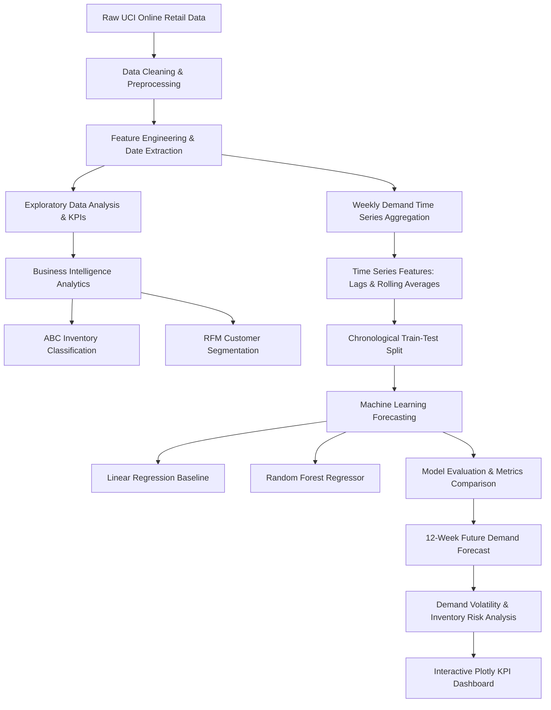

# Retail Demand Analysis and Sales Forecasting System

[](https://www.python.org/)
[](https://jupyter.org/)
[](https://scikit-learn.org/)
[](https://plotly.com/)
[](https://opensource.org/licenses/MIT)

An end-to-end business analytics and machine learning solution for analyzing historical retail transaction data, segmenting customers, classifying product inventory, and forecasting future weekly demand to optimize supply chain inventory planning.

---

## 📌 Executive Summary & Key KPIs

Using the **UCI Online Retail Dataset** spanning transactions across 38 countries:
- **Total Sales Revenue:** \$10,280,007.33
- **Total Units Sold:** 5,561,579 units
- **Total Orders:** 19,792 transactions
- **Average Order Value (AOV):** \$519.40
- **Revenue per Customer:** \$2,371.40
- **Unique Products:** 3,918 items
- **Customer Base:** 4,335 unique customers
- **Top Revenue Country:** United Kingdom
- **Highest Demand Product:** *PAPER CRAFT , LITTLE BIRDIE* (80,995 units)

---

## 🏗️ Project Architecture & Pipeline



---

## 🔍 Key Analytical Highlights

### 1. Data Cleaning & Integrity
- Deduplication of identical transactions.
- Parsing chronological timestamps (`InvoiceDate`) into temporal attributes (`Year`, `Month`, `Day`, `DayOfWeek`).
- Cancellation handling (negative quantities/credit memos).
- Validation of unit pricing and missing customer identifiers.

### 2. Business Intelligence & Segmentation
- **ABC Inventory Analysis:** Classifies inventory items according to Pareto's 80/20 principle:
  - **Category A:** Top ~80% of cumulative revenue (tight inventory control).
  - **Category B:** Next ~15% of revenue.
  - **Category C:** Remaining ~5% of revenue (low-value, high-variety products).
- **RFM Customer Segmentation:** Analyzes customer behavior along **Recency** (days since last purchase), **Frequency** (total orders placed), and **Monetary Value** (total spend) to isolate champions, loyal customers, at-risk buyers, and lost accounts.

### 3. Time Series Forecasting
Weekly retail demand is aggregated chronologically and augmented with time-series feature engineering:
- **Autoregressive Lags:** Prior week demand levels (`Demand_Lag_1`, `Demand_Lag_2`, `Demand_Lag_4`).
- **Rolling Windows:** 4-week and 8-week moving averages and rolling standard deviations.
- **Calendar Signals:** Month, quarter, and week of the year to capture seasonality.

---

## 📊 Model Evaluation & Results

Two models were benchmarked chronologically to predict future weekly demand:

| Model | MAE | RMSE | MAPE (%) |
| :--- | :---: | :---: | :---: |
| **Random Forest Regressor** | **39,068.19** | **48,182.13** | **21.50%** |
| Linear Regression | 89,963.19 | 96,231.79 | 52.33% |

> **Selected Model:** **Random Forest Regressor** demonstrated superior capability in capturing non-linear demand shifts and seasonal shocks, cutting Mean Absolute Percentage Error (MAPE) by more than half compared to the linear baseline.

### 12-Week Future Forecast & Risk Assessment
- Projected average weekly demand of **~181,066 units** over the subsequent quarter.
- Demand volatility analysis calculates coefficients of variation ($CV = \frac{\sigma}{\mu}$) per SKU to pinpoint high-risk items requiring dynamic safety buffer stock versus stable staple products.

---

## 📈 Interactive Dashboard

An interactive dashboard built with **Plotly** provides visual KPI cards and dynamic charts for:
- Historical vs. Predicted Weekly Demand
- Cumulative Revenue Trajectory
- Category & Geographic Sales Distribution
- Demand Volatility vs. Volume Matrix

---

## 📂 Project Structure

```text
├── .gitignore                                  # Git exclusion patterns
├── requirements.txt                            # Python dependencies
├── README.md                                   # Project documentation
└── Retail_Demand_Analysis_Online_Retail.ipynb  # End-to-end analytical notebook
```

---

## 🚀 Getting Started

### Prerequisites
- Python 3.8 or higher
- Jupyter Notebook or JupyterLab

### Installation

1. **Clone the repository:**
   ```bash
   git clone https://github.com/Ksairupesh/Retail-Demand-Analysis-and-Sales-Forecasting-System.git
   cd Retail-Demand-Analysis-and-Sales-Forecasting-System
   ```

2. **Create and activate a virtual environment (optional but recommended):**
   ```bash
   python -m venv venv
   # Windows:
   venv\Scripts\activate
   # macOS/Linux:
   source venv/bin/activate
   ```

3. **Install the dependencies:**
   ```bash
   pip install -r requirements.txt
   ```

4. **Obtain the Dataset:**
   - Download the **Online Retail** dataset from the [UCI Machine Learning Repository](https://archive.ics.uci.edu/dataset/352/online+retail) or [Kaggle](https://www.kaggle.com/datasets/carrie1/ecommerce-data).
   - Place `Online Retail.csv` (or `.xlsx`) into the project root directory.

5. **Run the Notebook:**
   ```bash
   jupyter notebook Retail_Demand_Analysis_Online_Retail.ipynb
   ```

---

## 💡 Strategic Business Recommendations

1. **Safety Stock Optimization:** Prioritize buffer stocks for Category A items exhibiting high coefficient of variation (e.g., volatile gift items and seasonal bestsellers).
2. **Targeted Customer Retention:** Deploy re-engagement campaigns to RFM segments flagging high historical monetary value with deteriorating recency.
3. **Geographic Expansion:** Leverage the United Kingdom fulfillment model to optimize regional logistics across secondary European markets.

---

## 👤 Author

- **K Sai Rupesh**
- GitHub: [@Ksairupesh](https://github.com/Ksairupesh)
